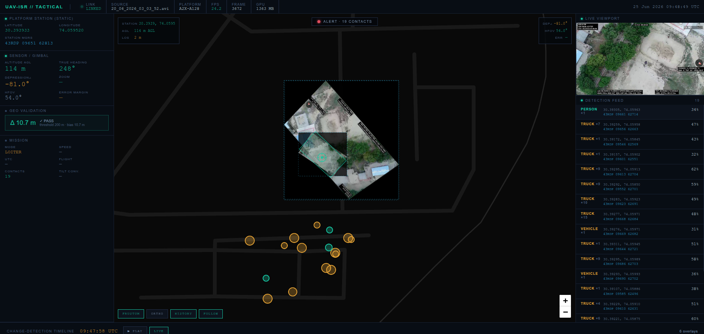
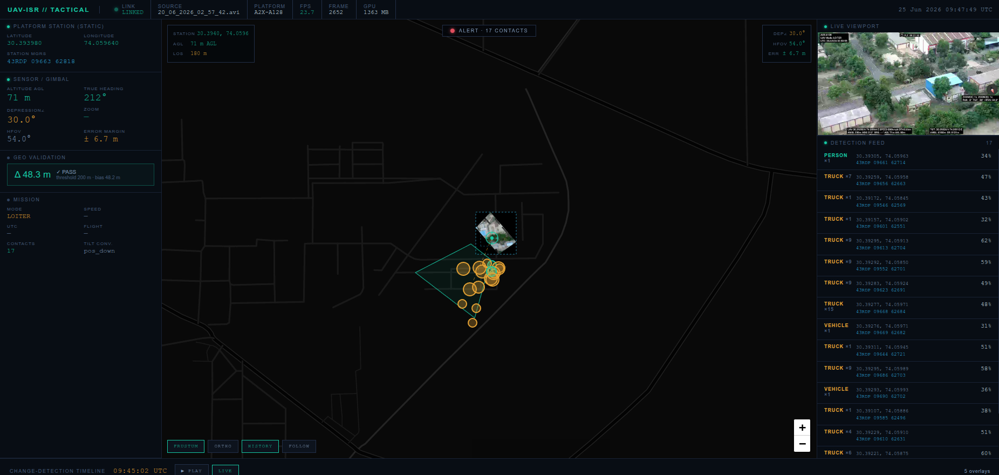

<p align="center">
  <strong>OVERWATCH ISR</strong><br/>
  <sub>Edge-Deployed UAV Intelligence, Surveillance & Reconnaissance Pipeline</sub>
</p>

<p align="center">
  
  
  
  
  
  
</p>

<p align="center">
  
</p>

---

## Overview

**OVERWATCH** is a self-contained, air-gapped ISR workstation that turns recorded drone footage into actionable intelligence — detected, geolocated, and mapped — entirely on a single edge PC. No cloud, no network link to the aircraft, no external dependencies at runtime.

The system ingests video recorded on an **Asteria A200-XT** UAV's SD card, recovers telemetry burned into the HUD overlay via OCR, runs **YOLOv11** object detection on a local GPU, projects every contact to a real-world coordinate using 3D ray-rotation against a **Copernicus DEM**, consolidates parallax-scattered detections into single-pin **Master Tracks**, orthorectifies oblique frames into a growing **orthomosaic**, and surfaces everything on a **Palantir-style tactical dashboard** with a time-scrubber for change detection.

```
SD Card  ──→  Decode  ──→  OCR Telemetry  ──→  YOLOv11 Detect  ──→  Ray-cast Geolocate
                                                                           │
              Dashboard  ←──  Master Track Merge  ←──  Kalman Smooth  ←────┘
                  │
         Ortho Stitch  ──→  History Tiles  ──→  Survey Export (WebODM)
```

---

## Key Capabilities

| Capability | Implementation |
|---|---|
| **Automated target detection** | YOLOv11 (Ultralytics) on RTX 5060 Ti, FP16, TensorRT `.engine` when available |
| **Terrain-corrected geolocation** | 3D ray-rotation in ENU frame → DEM ray-march (Copernicus GLO-30 via Rasterio) with flat-earth fallback |
| **Master Track de-duplication** | Same-class centroid clustering within 15 m collapses parallax scatter into one pin per object |
| **Ghost-movement suppression** | Platform isolation (stiff EMA), tilt-convention auto-calibration, TGT-anchor boresight bias removal |
| **Per-target error propagation** | Analytic finite-difference → per-contact ± metre accuracy figure |
| **Orthomosaic generation** | Telemetry-driven planar homography, HUD masking, ORB+RANSAC refinement, feathered alpha blend |
| **Tactical dashboard** | Flask + SocketIO → Leaflet dark map, live frustum, MGRS popups, timeline scrubber, ortho layer |
| **Survey-grade export** | Post-flight SfM prep: sharpness ranking, EXIF GPS (piexif), Split-Merge batching for WebODM |
| **Zero-crash fallback** | Every hardware/file/geometry operation is guarded; missing DEM, missing GPU, bad OCR → graceful degrade |

---

## System Requirements

| Component | Specification |
|---|---|
| **OS** | Ubuntu 24.04 LTS |
| **CPU** | Intel i5-12400F (or equivalent) |
| **GPU** | NVIDIA RTX 5060 Ti 16 GB (Blackwell sm_120, CUDA 12.8) |
| **RAM** | 16 GB system |
| **Python** | 3.10 – 3.12 |
| **Sensor** | Asteria A200-XT (1280×720 / 1920×1080, 3-axis gimbal, dual GNSS) |

---

## Quick Start

```bash
# 1. Clone
git clone git@github.com:ojasJO/overwatch-isr.git
cd overwatch-isr

# 2. Create virtual environment
python3 -m venv venv
source venv/bin/activate

# 3. Install PyTorch for CUDA 12.8 (must be done BEFORE requirements.txt)
pip install torch torchvision --index-url https://download.pytorch.org/whl/cu128

# 4. Install remaining dependencies
pip install -r requirements.txt

# 5. Drop your footage into the footage/ directory
cp /media/sdcard/20JUN26_025813.avi footage/

# 6. (Optional) Drop Copernicus GLO-30 DEM for terrain-corrected geolocation
cp fazilkacantt_dem.tif data/dem/

# 7. Run
python main.py

# 8. Open the tactical dashboard
#    http://localhost:5000
```

---

## Project Architecture

```
overwatch-isr/
├── main.py                     # Orchestrator: cleanup → discover → detect → geolocate → stitch → emit
├── config.py                   # Single source of truth (all tunables, paths, thresholds)
├── requirements.txt            # Pinned dependencies (torch installed separately)
├── .gitignore
│
├── src/
│   ├── __init__.py
│   ├── video_processor.py      # HW-accelerated decode + EasyOCR HUD telemetry extraction
│   ├── detector.py             # YOLOv11 inference (TensorRT .engine or .pt, FP16, optional SAHI)
│   ├── geolocator.py           # 3D ray-rotation, DEM ray-march, Kalman tracking, MGRS, Master Tracks
│   ├── stitcher.py             # Orthorectification (planar homography), ORB/RANSAC, feather blend
│   ├── dashboard.py            # Flask + SocketIO backend + embedded Leaflet tactical frontend
│   └── survey_processor.py     # Post-flight SfM export for WebODM (sharpness filter, EXIF GPS)
│
├── footage/                    # Input: recorded .avi / .mp4 from the drone's SD card
├── history/                    # Output: geo-referenced tiles + manifest.json + orthomosaic.jpg
├── data/dem/                   # Copernicus GLO-30 DEM GeoTIFF (optional; enables terrain correction)
├── models/                     # YOLO weights (.pt / .engine) — auto-downloads if absent
└── survey_export/              # Post-flight: SfM-ready frames with EXIF GPS for WebODM
```

### Module Responsibilities

| Module | Role |
|---|---|
| `main.py` | Boot-time hard purge of stale history; footage discovery and chronological sort; dashboard boot on a daemon thread; per-frame loop: decode → OCR → detect → geolocate → cluster → stitch → emit → persist; mosaic refresh; keeps dashboard alive for post-run review. |
| `config.py` | Every tunable in one place: directories, frame stride, camera intrinsic bounds, YOLO class map + confidence/IOU, OCR gating rates, geolocation/DEM/tracking constants, stitcher parameters, dashboard port. |
| `video_processor.py` | HW-accelerated frame decode with graceful fallback. Region-of-interest OCR via EasyOCR against the burned-in HUD. Plausibility gate + last-known-good hold (a legitimate `0` is never discarded). `HistoryWriter` persists geo-referenced tiles + JSON manifest. |
| `detector.py` | YOLOv11 via Ultralytics. Loads TensorRT `.engine` (max throughput on Blackwell) → `.pt` checkpoint → stock model. FP16 on CUDA. Optional SAHI sliced inference for tiny top-down objects. Lazy `torch`/`ultralytics` import so the system boots without CUDA. |
| `geolocator.py` | The geometric core: 3D ray-rotation pixel → ground intersection; DEM ray-march via Rasterio; tilt-convention auto-calibration; platform isolation (stiff EMA); TGT-anchor systematic bias removal; per-target constant-position Kalman; analytic error propagation; dependency-free MGRS encoder; `MasterTrackRegistry` same-class centroid clustering (15 m merge radius). |
| `stitcher.py` | `OrthoStitcher`: telemetry gate (AGL ≥ 50 m, zoom ≤ 1×, depression ≥ 45°); orthorectification via planar homography from the (DEM-corrected) ground footprint; HUD-band masking; ORB + Lowe ratio + RANSAC similarity refinement; feathered alpha blend on a geo-referenced canvas. GPU path via `cv2.cuda` when the OpenCV build provides it; CPU fallback otherwise. |
| `dashboard.py` | Flask + SocketIO (threading, no eventlet). Embedded Leaflet frontend: dark Carto tiles, static station marker, dynamic frustum polygon + LOS line, Master Track pins with military popups (sans headers, mono MGRS/coords), telemetry grid, validation badge, Ortho + History layer toggles, change-detection timeline scrubber. |
| `survey_processor.py` | Standalone post-flight tool. Reads `history/manifest.json`, filters oblique/blurry/low-confidence frames, ranks by Laplacian sharpness, spatially de-duplicates, writes EXIF GPS via `piexif`, stages into `survey_export/` with an ODM `geo.txt`, and emits a CUDA Docker command with Split-Merge (`--split 300`) for OOM-safe WebODM ingestion. |

---

## The Physics

### Geolocation: 3D Ray-Rotation

Each detection pixel is projected to the ground by constructing the camera's boresight, right, and down basis vectors in an **East-North-Up (ENU)** frame from the gimbal's depression angle, azimuth (heading + pan), and HFOV-derived focal length, then intersecting the per-pixel ray with the ground surface.

**Why not flat-earth tangent?** The common shortcut of computing a single slant range and applying a constant GSD is an orthographic approximation that breaks at oblique angles — it ignores perspective foreshortening and mislocates off-axis pixels with error growing toward the frame edges and toward the horizon. The ray-rotation method handles the full trapezoidal footprint and remains stable at, near, and through nadir.

### Terrain Correction: DEM Ray-March

A flat ground plane at constant AGL is wrong over sloped terrain. The DEM ray-march uses the drone's **AMSL** as the vertical datum and steps the viewing ray through a Copernicus GLO-30 elevation grid, bracketing the first sign change of `ray_altitude − terrain_altitude`, then bisecting to sub-centimetre precision. If the DEM is missing or the ray leaves coverage, the system silently falls back to flat-earth.

### Orthorectification: Planar Homography

An oblique frame and a nadiral view of flat ground are related by an 8-DOF **planar homography**. The pipeline ray-casts the four image corners to (DEM-corrected) ground positions in metres, rasterizes them north-up at a fixed GSD, and solves the DLT for the transformation matrix. `warpPerspective` resamples the frame into a north-up tile. Frames with depression < 45° are rejected (the "Trapezoid of Death" — 2D ortho degenerates near the horizon).

### Master Track Clustering

A single physical object (e.g., a parked truck) is detected from many gimbal angles across a loiter, producing a scattered cluster of dots. The `MasterTrackRegistry` merges same-class detections within a 15 m radius into a single running-centroid pin, so the map shows **one dot per object, not fifteen**.

---

## Dashboard

The tactical UI is a single-page Leaflet application served by Flask + SocketIO at `http://localhost:5000`.

<p align="center">
  
  <br/><sub>Oblique pass — live frustum projected onto the map, Master Track pins, and ± error margin from the ray-cast geolocator.</sub>
</p>

| Panel | Content |
|---|---|
| **Left** | Platform station (static, isolated) with MGRS; sensor/gimbal telemetry grid (AGL, heading, depression, zoom, error margin); geo-validation badge; mission block |
| **Centre** | Dark Leaflet map with static station marker, dynamic frustum polygon + LOS line, Master Track contact pins with military popups; toggleable Ortho + History layers |
| **Right** | Live viewport (current frame with detection boxes); scrollable detection feed (click to fly-to) |
| **Bottom** | Change-detection timeline scrubber — drag to reveal historical coverage by timestamp; Play / Live controls |

---

## Post-Flight Survey Export

For survey-grade orthomosaics (Structure from Motion via WebODM):

```bash
# Prepare the export (select best frames, write EXIF GPS, generate geo.txt)
python -m src.survey_processor --source history --out survey_export

# Launch WebODM (requires Docker + NVIDIA Container Toolkit)
bash survey_export/run_survey.sh
```

The tool filters oblique/blurry frames, ranks by sharpness, spatially de-duplicates, writes GPS EXIF into the JPEGs, and generates a Split-Merge Docker command (`--split 300 --gpus all`) to keep WebODM under 16 GB RAM.

---

## Configuration

All tunables live in `config.py`. Key parameters:

| Parameter | Default | Role |
|---|---|---|
| `FRAME_STRIDE` | `3` | Process every Nth frame |
| `CONFIDENCE_THRESHOLD` | `0.30` | YOLO detection gate |
| `PLATFORM_EMA_ALPHA` | `0.05` | Platform isolation stiffness (smaller = steadier) |
| `USE_DEM` | `True` | Enable terrain-corrected ray-cast |
| `STITCH_MIN_DEPRESSION_DEG` | `45.0` | Reject oblique frames from the mosaic |
| `STITCH_GSD_M` | `0.15` | Orthomosaic ground sample distance (m/px) |
| `MGRS_PRECISION` | `5` | 1 m MGRS grid |
| `DASHBOARD_PORT` | `5000` | Tactical UI port |

---

## License

MIT

---

<sub>Built for edge deployment. No cloud. No network. Just the footage and the machine.</sub>